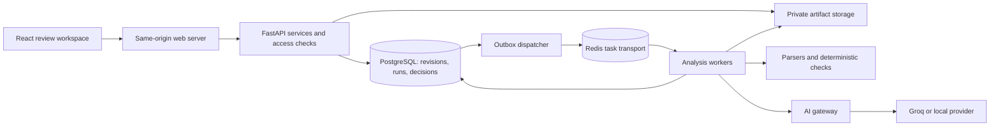

# SRS Reviewer implementation plan

Drafted 2 November 2026. Based on `PROJECT_REVIEW_2026-11-02.md` and reviewed commit `64dfaf1`.

This is an implementation plan, not a claim that the changes are already complete. It covers all defects and improvement areas in the audit, plus the features needed for an excellent requirements-review product. “10/10” means meeting the release criteria below and demonstrating the result with users; it is not a guarantee of perfection or universal document support.

## 1. Product outcome and scope

Build an explainable requirements-review workspace for students, instructors, and small software teams. A user must be able to complete this journey without manual database edits, repeated uploads, or unexplained refreshes:

**Create project → upload artifacts → verify extraction → analyze → inspect evidence → edit or review suggestions → save a revision → compare changes → export/share with authorized reviewers.**

Working assumptions:

- Preserve React, TypeScript, Tailwind/Radix, FastAPI, SQLAlchemy, and Alembic; evolve the existing modules.
- The complete target supports a modest classroom/team deployment, initially tested at 20 concurrent active users and four active analysis workers. These are proposed capacity targets, not measured current capabilities.
- The full target includes private projects, controlled collaboration, deterministic-only analysis, Groq integration, a local-provider adapter, and evidence-backed semantic suggestions.
- Support a documented DOCX/text-PDF/PlantUML syntax subset. Scanned PDFs are detected and explained; OCR becomes an explicit subsequent capability with its own accuracy evaluation, rather than silently pretending image-only files were analyzed.
- Public deployment is gated on security and correctness. Each milestone remains usable and reviewable on its own.

## 2. Architecture decisions

| Concern | Default decision | Reason |
|---|---|---|
| Application structure | Modular monolith, one repository | Existing boundaries are appropriate and affordable to maintain. |
| Browser client | React/TypeScript + existing TanStack Query + generated OpenAPI types | Shared fetching, reliable polling, explicit contracts, fewer duplicate state systems. |
| API | FastAPI; thin routers, authorization dependencies, application services | Makes ownership and transaction behavior consistent. |
| Shared-deployment database | PostgreSQL; SQLite retained only for supported lightweight local mode | Reliable concurrent transactions and production migration testing. |
| Analysis execution | Celery workers with Redis transport; PostgreSQL owns run state | Separates long analysis from request handling and supports controlled retries. |
| Dispatch reliability | Transactional outbox in PostgreSQL; dispatcher publishes run IDs | Prevents a committed run from being lost between database commit and queue publication. |
| Files | Private storage interface; mounted volume initially, shared by API/worker | Keeps deployment simple while permitting later object storage. |
| Web serving | Built frontend behind a same-origin `/api` reverse proxy | Eliminates localhost/port mismatches and simplifies browser security. |
| Browser authentication | Revocable server sessions in HttpOnly cookies, secure in production; CSRF tokens and origin checks for mutations | One coherent session lifecycle with meaningful logout and recovery. |
| Live progress | TanStack Query polls active runs initially; SSE only if measured need justifies it | Delivers reliable progress with a small initial implementation. |
| AI integration | One gateway for privacy, budgets, validated outputs, retries, caching, and provider adapters | All external AI paths follow the same rules. |

FastAPI's documentation recommends considering a separate task system for heavy background work. Celery's task documentation explains that redelivery requires idempotent tasks and deliberate acknowledgement settings; adopting a queue does not itself guarantee exactly-once execution. These inform the design above. [FastAPI background tasks](https://fastapi.tiangolo.com/tutorial/background-tasks/), [Celery task lifecycle](https://docs.celeryq.dev/en/stable/userguide/tasks.html).

Run Celery workers in Linux containers for the Windows development environment. Do not assume native Windows worker behavior matches production.

## 3. Data and API contract

Introduce stable identities before building editing, collaboration, and advanced comparison:

- **Project:** stable identity, owner, name, description, archive state, membership. Names are display values, never identity keys.
- **ProjectRevision:** project ID, revision number, parent revision, draft/sealed state, author, timestamps, profile version. Unique `(project_id, revision_number)`.
- **Artifact:** revision ID, type, original filename, storage key, content hash, validation status and metadata. Permit multiple diagrams of a type with explicit diagram IDs; prohibit silent replacement.
- **Requirement / UMLElement:** internal immutable element ID within a revision, optional authored ID, normalized representation, extraction warnings, structured source spans. Store explicit lineage mappings across revisions; do not equate an optional `FR-1` with database identity.
- **AnalysisRun:** revision, status/stage, requested modes, versions of parsers/rules/prompts/models, input hashes, progress, timing, budget consumption, attempt/lease identity, error code and user-safe message.
- **Finding:** run, rule, severity, affected element(s), source evidence, origin, stable comparison fingerprint, and suggested correction. A fingerprint includes rule and affected occurrence/targets, so multiple findings for one requirement cannot overwrite each other.
- **TraceLink:** typed endpoints, relation, origin, evidence, similarity/confidence semantics, and run. Endpoint existence is enforced.
- **ReviewDecision:** actor, decision, reason, timestamp, referenced finding/link and review revision. Keep decisions separately from generated findings.
- **QualityScore:** run, rubric version, applicability, evaluation coverage, raw scores, weighted contributions, and any decision-adjusted snapshot. Never silently rewrite a prior exported score.
- **LLMCall / LLMCache:** separate usage/error audit from validated, scoped cache data. Cache entries include schema/prompt/model versions, expiry, and owner/project scope.
- **Session / AuditEvent / OutboxEvent:** support revocable sessions, auditable changes, and reliable dispatch.

API conventions:

- Version new contracts under `/api/v1`; retain a temporary adapter for existing routes until the frontend migrates.
- Start analysis with `POST /projects/{id}/revisions/{revision}/runs`; return `202` and a run ID, not a completed report.
- Expose status/progress and a report projection at `/runs/{id}` and `/runs/{id}/report`; report data includes scores, evaluated scope, source spans, findings, links, and warnings.
- Use explicit endpoints for draft edits, artifact uploads/removal, extraction corrections, review decisions, run cancellation, revision comparison, and authorized exports.
- Use request idempotency keys for project/draft creation, upload finalization, and analysis creation. Repeating a request returns its existing result.
- All resource retrieval, exports, progress events, and mutations resolve project membership centrally. Pagination, filter bounds, UTC timestamps, typed errors, and response schemas are part of the contract.
- Use optimistic concurrency/version fields for draft and reviewer edits; return a conflict instead of overwriting another editor's change.

## 4. Milestones and acceptance gates

Effort estimates are focused engineer-days including implementation and normal tests. They assume familiarity with the stack and will be revised after the first milestone. They are not delivery promises.

| Milestone | Primary owners | Dependency | Effort |
|---|---|---|---:|
| M0: Baseline, regression fixtures, measurable scope | Full stack / QA | None | 2–3 days |
| M1: Security and working setup | Backend / infrastructure | M0 | 4–6 days |
| M2: Parsing, traceability, scoring correctness | Analysis / backend | M0; merge after M1 | 7–10 days |
| M3: Revisions, analysis history, safe migration | Backend / data | M1–M2 | 6–9 days |
| M4: Durable jobs and recovery | Backend / infrastructure | M3 | 4–6 days |
| M5: Reliable AI and privacy | Analysis / backend | M2–M4 | 5–8 days |
| M6: Complete, accessible review workspace | Frontend / UX | M3 contracts; integrate M4–M5 | 8–12 days |
| M7: Differentiating product features | Full stack / analysis | M5–M6 | 8–14 days |
| M8: Release qualification and operating guide | QA / infrastructure | All relevant milestones | 5–8 days |

Total initial scope: **49–76 focused engineer-days**. Allow roughly **12–19 calendar weeks for one full-time developer**, including integration/review contingency. Two experienced developers can overlap independent work, but schema, correctness, and integration dependencies still determine delivery. A semester team working part time should schedule by available hours, not assume these are calendar-day estimates. M1–M2 provide an earlier stabilized demonstration; the complete target includes M7–M8.

### M0 — Establish trustworthy evidence

1. Capture current build/test commands, installed versus locked dependencies, benchmark outputs, and representative API responses. Create a maintained development dependency set and one documented local check command.
2. Convert audit reproductions into minimal isolated regression fixtures: two users, a table-based SRS, missing IDs, use-case aliases, public methods, an empty project, persistent links, a nonsense rewrite, and failed uploads.
3. Replace test expectations that accept incorrect extraction. Scope all monkeypatches and database fixtures; enable foreign keys in SQLite tests. Make integration tests independent of existing user databases/files.
4. Establish a real rendered review environment using supported browser tooling. Capture desktop/mobile pages and assess keyboard navigation, zoom, contrast, and print; prior visual ratings remain provisional until this happens.
5. Define supported syntax and input resource budgets. Start from the existing 10 MB upload limit; measure suitable page, requirement, decompressed-byte, parse-time, and AI token limits rather than introducing unexplained arbitrary capacity claims.

**Gate:** A failing regression exists for each confirmed defect; fresh setup/build commands are reproducible; benchmark and visual-review procedures are written. Known failures remain explicitly tracked until fixed, and no failing suite is represented as green.

### M1 — Close release-blocking access and validation gaps

**Access and authentication**

- Add shared `require_project_access` / resource-resolution services and apply them to findings, links, updates, downloads, export, compare, and future run endpoints.
- Validate non-empty names and password policy at the API boundary, normalize email consistently, enforce practical field sizes, and handle uniqueness races without returning raw database errors.
- Validate malformed JWT subjects during transition; introduce revocable browser sessions with secure cookie settings, CSRF protection, session rotation, expiry, and logout invalidation. Preserve old password hashes through verify-and-upgrade on login. Do not reset existing users' passwords as a migration shortcut.
- Implement password-reset and email-verification tokens with expiry, single use, hashed storage, enumeration-resistant responses, and a local development mail sink. Hosted delivery requires a configured mail service before release.
- Rate-limit signup/login/recovery and independently limit uploads, queued analyses, and provider usage. Use shared limits across workers; communicate retry timing.

**Uploads and setup**

- Enforce body limits at the proxy and application stream boundary. Check DOCX package structure, PDF readability, UTF-8/text limits, and useful PlantUML parsing; distinguish valid-but-unextractable files from corrupt files.
- Bound ZIP expansion, page count, parser runtime, and worker memory. Reject external PlantUML includes and network/file access in any later renderer. Store files privately and serve them through authorization.
- Write to temporary storage, validate, finalize atomically, then attach to a draft; clean abandoned uploads safely. A failed upload preserves the previous artifact and can be retried without a new project.
- Upgrade affected dependency families using current advisories and compatibility checks; lock runtime/test dependencies. Add secret and dependency scanning.
- Fix API URLs using same-origin `/api`, consistent proxy routing, `.env.example`, Docker ignore files, and separate development/production configuration. Ensure `.env`, databases, uploads, and caches are excluded from images.

**Gate:** Every cross-user read/write/export probe is denied; empty credentials and invalid documents fail predictably; revoked sessions stop working; CSRF checks reject unauthorized cross-origin mutations; fresh local and Compose signup/upload calls reach the correct backend. No unresolved reachable high/critical dependency issue or exposed secret remains.

### M2 — Make analysis accurate and scores defensible

**Requirement extraction**

- Iterate DOCX body blocks in original order. Recognize table column semantics and preserve row IDs/statements, merged cells, wrapped text, and source locations.
- Give every extracted occurrence an internal ID, including missing/duplicate authored IDs. Keep optional authored IDs for display and rule evaluation.
- Use token-boundary detection for normative verbs; support explicitly documented `shall`, `must`, and identified-requirement patterns. Flag ambiguous extraction rather than merging unrelated text without evidence.
- Detect headings from styles and numbering, preserve provenance, and attach classification confidence/reason. Test PDF page breaks, headers/footers, columns, and scanned documents; detect unsupported layouts without reporting success.
- Persist source spans through findings, API contracts, and exports. Store manual extraction corrections as a new draft/revision, never by overwriting original source bytes.

**UML and traceability**

- Replace scattered regex assumptions with a normalized parser/symbol table for the supported PlantUML subset. Retain aliases, visibility, method parameters/returns, diagram identity, and operation receiver identity.
- Handle supported use-case/class/sequence syntax consistently; unsupported constructs produce an actionable warning. Test aliases, duplicate labels, overloaded operations, namespaces within scope, and disconnected elements.
- Guard optional IDs and use exact normalized authored-ID tokens. `FR-1` must not match `FR-10`. Stable endpoint IDs distinguish equal labels across diagrams.
- Build links independently for all available artifact pairs. Implement explicit graph traversal for transitive coverage and sequence-orphan checks, with path evidence and cycle protection.
- Keep inference score distinct from confirmed evidence. Revalidate reviewer decisions against current endpoints and carry them forward only when lineage/content is compatible; otherwise mark them stale.

**Scoring specification**

- Introduce analysis profiles: SRS-only and SRS-plus-architecture initially. Select scope before a run. A missing required input blocks that profile; an optional category is explicitly not applicable, never full-credit evidence.
- Empty/unextractable documents receive no final quality score. Partial analyses display available category results and coverage, with no misleading final overall grade.
- Normalize deterministic penalties by stable eligible input counts, not generated links or newly inserted records. Trace coverage uses expected source/relation obligations and exposes suggested versus confirmed coverage separately.
- Preserve separate category percentages and weighted contributions. Version the rubric and snapshot it with the run; scores from different scopes/rubrics are labelled non-comparable.
- Keep raw machine findings/scores separate from reviewer-adjusted results. Decisions trigger an explicit derived snapshot, leaving historical reports intact.
- Review NFR rules by subtype: performance claims may need metrics; a verifiable security requirement need not contain an arbitrary number. Avoid training the repair loop to invent thresholds to satisfy a simplistic regex.

**Gate:** The table, missing-ID, alias, public-method, empty-score, source-reference, and persistent-link regressions pass. Confirming unchanged links cannot reduce coverage. Input reordering or re-running the same deterministic inputs/configuration produces equivalent results. Every score is explainable from its inputs and rubric.

### M3 — Preserve revisions and analysis history

- Add the schema from section 3 using additive migrations and explicit foreign keys/uniqueness/indexes. Make SQLite connection options conditional; execute integration tests on PostgreSQL.
- Separate drafts from sealed revisions. Only drafts accept artifact edits; analyzing/completed revisions are immutable. Replacing a file branches a new draft and marks derived data pending.
- Retain successful reports while a newer run is queued, running, partial, or failed. Publish a completed snapshot and update its pointer in one transaction. Roll back failed sessions before recording errors.
- Implement list/filter/pagination and report/score APIs. Remove name-based version allocation and use transactional revision allocation.
- Compare runs using rule identity, element lineage, source occurrence, and related targets. Do not collapse several conflicts or missing sections into one dictionary entry. Show added/changed/deleted requirements and new/resolved/persistent findings separately; identify rule/profile changes.
- Add explicit archive, restore, and delete semantics. Delete requires ownership, confirmation in the product, safe file cleanup, and a documented retention policy.

**Migration procedure**

1. Back up database and uploaded artifacts together; generate row counts, ID mappings, file existence checks, and hashes.
2. Add new tables/columns without removing the old ones. Produce a dry-run mapping report.
3. Preserve each legacy project as an independent stable project/revision by default. Legacy same-name/version relationships may be proposed for consolidation, but ambiguous groups are never silently merged. Preserve original IDs/version labels as legacy metadata.
4. Import existing reports as legacy runs, with `unknown` versions/coverage where unavailable. Do not reconstruct missing source locations or advertise historical scores as recalculated results.
5. Reconcile counts, ownership, artifacts, and decisions. Switch readers/writers through a compatibility adapter and verify old links redirect to their mapped resources.
6. Take a short write freeze for final migration/cutover. Retain the old schema and backup until the release is verified. Prefer forward repair; any restore rollback must explicitly account for writes since cutover.

**Gate:** A migration rehearsal on a copy preserves all users, documents, findings, and ownership. Colliding names do not merge accidentally. Concurrent revision creation cannot duplicate numbers. A failed reanalysis leaves the last complete report available. Backup restoration is demonstrated.

### M4 — Make long-running work recoverable

- Create the run and outbox entry together; return `202`. A dispatcher publishes only the run ID. A reconciler handles undelivered outbox records and stale queued/running work.
- Workers claim runs atomically and record attempt IDs, heartbeat, lease expiry, stage, counts, and stage output hashes. Old attempts cannot publish after a lease is superseded.
- Use at-least-once delivery with idempotent stage writes. Configure acknowledgements and worker-loss handling deliberately; bound retries and prevent poison jobs from looping.
- Remove blanket startup invalidation. Recover only expired leases. Parser corruption is a permanent input error; a transient provider outage gets bounded exponential backoff with jitter.
- Support cooperative cancellation between stages/calls and hard timeouts for bounded parsing/provider requests. A cancellation cannot falsely promise that an already-sent provider request was undone.
- Persist useful deterministic results if AI fails, expose partial status and exactly which checks were skipped, and preserve the previous complete run.
- Make statuses explicit: queued, running, completed, partial, failed, cancelled; stage and percentage/counts are separate fields. Do not invent percentages for unknown-duration provider work.

**Gate:** Kill/restart a worker and restart the API/broker during a synthetic job; the job recovers or reaches an explained bounded failure without duplicate published findings. Repeated start requests create one run. Cancelling a job prevents subsequent publication. API reads remain responsive while analysis is busy.

### M5 — Make AI suggestions constrained and reviewable

- Route testability, conflicts, repair, and later generation through one AI gateway. Apply consistent redaction/minimization, provider selection, timeouts, and request/token/cost budgets. Include failed and retried calls in accounting; distinguish known provider usage from estimates after ambiguous timeouts.
- Keep deterministic-only mode fully functional. Mock mode is test/demo-only and clearly labelled; production cannot silently fall back to fabricated findings.
- Version prompts and output schemas. Validate returned IDs, count/coverage, allowed fields, evidence references, and response completion. Unknown IDs or truncated responses cannot become authoritative findings.
- Cache only validated responses under owner/project scope, artifact/prompt/schema/model versions, and expiry. Invalidate malformed entries and bypass their cache on retry. Keep call logs separate with retention controls and minimal sensitive content.
- Batch testability within measured token budgets. Use candidate retrieval for conflicts but publish the evaluated coverage and benchmark missed-pair recall; a limited search cannot claim it proved no conflict exists.
- Repair with original text, subtype, constraints, relevant neighboring/conflicting requirements, and source references. Require meaningful normative structure and preserve negation, actors, quantities, units, exceptions, and intent. Flag unsupported changes and unknown thresholds for human input.
- Re-run applicable deterministic checks and targeted semantic/consistency checks. A second model opinion is evidence, not proof. Replace a boolean verified badge with check results and review status.
- Do not apply generated changes automatically. Accept/edit/reject records a decision; accepted content creates a draft change and must be analyzed as part of a revision.
- Treat document text as untrusted data. Embedded instructions cannot change prompts, trigger tools/network access, select another project, or expose other documents. Test prompt-injection fixtures.
- Present safe user error codes/messages; keep raw provider diagnostics access-controlled and scrubbed. AI-stage or repair failure remains visible in run coverage.

**Gate:** “Hello.”, empty output, unknown IDs, altered negation, invented metrics, malformed cached JSON, and dropped requirements are rejected or explicitly require review. Every outbound path passes the privacy tests. Budget exhaustion yields useful partial results. Live opt-in provider checks measure quality, latency, and token use; ordinary CI uses deterministic fakes.

### M6 — Build the complete review workspace

**Frontend foundation**

- Generate API types from OpenAPI, create query/mutation hooks, and use one session provider. Remove localStorage token dependence and stale instructor assumptions during the auth transition.
- Add session-expiry handling, request cancellation, an error boundary, normalized API errors, and reliable status handling for downloads/PATCH responses. Failures must never masquerade as empty successful data.
- Poll active runs every two seconds initially, pause unnecessary background polling, back off on transient failures, and stop at terminal states. Invalidate affected reports after reviewer actions.
- Split the report into feature components: summary, finding list, source panel, trace matrix, revision diff, run status, and export actions. Persist useful filters/tab/selected finding in the URL.

**Screens and interactions**

| Surface | Required behavior |
|---|---|
| Dashboard | Recent projects, active/failed/partial runs, useful next actions, score trend only for comparable runs. |
| Project workspace | Stable project details, revision timeline, draft/artifact management, rename/archive/restore, analysis history. |
| Upload flow | Saved draft, file validation/progress, multiple named diagrams, resumable retry, no duplicate-project creation. |
| Extraction preview | Counts, warnings, source text, classification and ID correction, explicit confirmation of evaluated scope. |
| Analysis view | Real stage/count information, bounded retry/cancel, reconnect after refresh, partial results and safe errors. |
| Report | Summary/coverage/scores first, prioritized findings, source evidence, filter/search, reviewer states, full export. |
| Correction view | Original and proposed text, inline diff, validation results, edit/accept/reject, undo in draft, rerun affected checks. |
| Traceability | Matrix plus graph where helpful; confidence/evidence, suggested/confirmed/rejected/stale states, manual add/remove, bulk review. |
| Compare view | Revision selectors, changed requirements, architecture impact paths, new/resolved/persistent defects, rubric-change notices. |

**Visual and accessibility direction**

- Retain the recognizable technical character while using 14–16px body text, clear headings, stronger contrast, semantic tokens, and consistent spacing. Add light/dark and comfortable/compact options through tokens, not duplicated page styles.
- Make keyboard focus visible and predictable. Use accessible buttons for disclosure/drop-zone actions, correct tab semantics, labelled icon controls, dialog focus handling, and live progress/error announcements.
- Reserve a mobile navigation header, adapt source/detail panes into a drawer or stacked view, and give large matrices an intentional horizontal viewport. Avoid page-wide accidental overflow.
- Provide primary touch controls around 44px as a product design target; check applicable WCAG minimum target/spacing and contrast rules. Validate at 360px, 768px, and 1440px widths and at 200% zoom.
- Replace internal-sounding terminology with clear actions. Add a real favicon, sample project walkthrough, explanatory rule text, and meaningful zero/loading/error/partial states.
- Make complete printable/export views independent of the selected tab. Remove navigation and dark backgrounds from print output; preserve headings, source references, and page breaks.

The accessibility acceptance target is WCAG 2.2 AA for the supported workflows, combining automation with manual keyboard/screen-reader review. An automated scan alone cannot establish conformance. [W3C WCAG 2.2](https://www.w3.org/TR/WCAG22/).

**Gate:** A first-time user completes the core journey on desktop and mobile without a manual refresh. All primary tasks work by keyboard. Server errors, expired sessions, interrupted uploads, empty filters, and partial runs render distinct recoverable states. All score displays match the API and no unsupported AI verification claim remains.

### M7 — Add the capabilities that distinguish the project

| Work item | Implementation scope | Acceptance evidence |
|---|---|---|
| Profiles and rubrics | Versioned templates, expected sections, severity/rule switches, lexicon, scoring weights, required artifacts | Prior reports reproduce their original configuration; incompatible comparisons are identified. |
| Complete exports | PDF and DOCX reports, trace CSV/JSON, revised DOCX or explicit patch/change list | Scores, scope, sources, decisions, and run metadata match the chosen snapshot; CSV formula-like cells are neutralized. |
| Corrected-document output | Apply accepted changes to supported source spans in a new file; keep originals | Supported paragraph/table edits preserve content/formatting in fixtures; unsupported edits are reported, never silently dropped. PDF inputs produce an explicit editable reconstruction/change list, not a promise of lossless PDF editing. |
| Collaborative review | Private memberships with owner/editor/reviewer/viewer roles; comments and assignment of findings; local in-app notifications | Full role/action matrix tested, including exports and events; concurrent reviews cannot overwrite silently; audit history identifies the actor. |
| Classroom workflow | Course/assignment grouping, instructor-owned rubric snapshots, explicit submission revisions, instructor access only to submissions they supervise | Instructor status alone cannot read every project; submitted revisions and grading context remain stable. |
| Better trace suggestions | Compare corrected lexical matching against local embeddings/reranking; store versioned model and evidence | Held-out link precision/recall improves over baseline before enabling by default; confidence is not falsely represented as a calibrated probability. |
| Change impact | Traverse requirement/use-case/sequence/class links to show affected artifacts/tests | Known dependency paths are identified, stale paths are distinguished, and evidence is navigable. |
| Draft test generation | Generate acceptance criteria and Given/When/Then cases linked to requirement versions | Every output cites a real requirement, unsupported assumptions are labelled, and human acceptance is required before export. |
| Private processing | Local provider adapter with the same schema/budget contract; deterministic-only mode without external AI | Offline deterministic run succeeds; private-mode outbound network tests show no provider/document leakage. |

Object-storage hosting, OCR, enterprise SSO, and deep issue-tracker integrations are extension points after the defined release. They are not needed to claim completion of the audited fixes, and each requires its own scoped acceptance tests before being advertised.

**Gate:** Features integrate into the same revision/ownership/review model. Semantic features earn their place through benchmark results, and collaboration passes expanded isolation checks.

### M8 — Qualify and operate the release

**Automated quality gates**

- Backend unit/property tests for parsers, scoring invariants, identities, and graph traversal; API integration tests with PostgreSQL; isolated migration/backfill tests.
- Frontend component tests for state/error branches and browser E2E for create → upload → extraction → run → review → revise → compare → export.
- Security tests for cross-user access, role permissions, malformed authentication, CSRF, throttling, unauthorized downloads, hostile document contents, and safe export handling.
- Worker fault/recovery tests for duplicate dispatch, expired leases, cancellation, storage/provider outages, and transactional publication.
- CI runs lint/type checks, `npm ci` and production build, locked Python installs, tests, dependency/secret scans, and a Compose smoke flow. Keep costly live-provider evaluation separate and explicitly enabled.

**Evidence corpus and proposed targets**

Build at least 50 representative real-format documents, 1,000 requirement occurrences, and 100 PlantUML fixtures across the supported syntax. Split by document/project family, freeze held-out data, and avoid deriving the test set from the implementation's rules. Use independent occurrence IDs in evaluation so duplicate/missing authored IDs cannot collapse cases. Obtain permission for any real private documents; otherwise use synthetic/publicly reusable examples.

| Dimension | Proposed release target and measurement |
|---|---|
| Supported-format extraction | At least 95% requirement precision and recall on the held-out corpus; report DOCX tables and text PDFs separately. |
| Deterministic rules | At least 95% precision and 90% recall on adequately represented rule classes; publish counts and limitations for rare classes. |
| Trace suggestions | At least 90% precision and 85% recall on independently labelled supported links; compare with the corrected lexical baseline. |
| Repair usefulness | At least 90% of a held-out sample judged useful and intent-preserving by reviewers; all accepted outputs pass applicable checks. Report sample size, disagreements, and critical semantic errors. |
| Reliability | All known audit regressions and failure-recovery scenarios pass; repeated jobs publish no duplicate report. |
| Interaction latency | Ordinary read/list API p95 under 500ms and analysis acceptance p95 under 1s at the defined load on documented hardware. |
| Deterministic throughput | Initial target: p95 under 10s for a supported 50-requirement/three-diagram sample on the reference host. Measure separately from queue and provider latency. |
| AI latency and expense | Report queue, provider, and repair-stage timings separately; enforce configurable project/user budgets and hard deadlines. No universal external-provider latency promise. |
| Accessibility | Primary journeys reviewed against WCAG 2.2 AA; automated scans have no unresolved serious/critical issues, with manual findings tracked and fixed. |
| Usability | At least 4 of 5 representative participants finish the core journey without intervention; every observed blocking problem is resolved and retested. This is formative evidence, not statistical proof. |
| Data protection | Two-user and role matrices pass for every resource; backup restore recovers database and matching artifacts; no secrets/documents in public assets or ordinary logs. |

These are targets to validate, not results already achieved. Report confidence intervals where useful, per-format/rule breakdowns, and deviations; do not hide weak categories behind one overall F1.

**Operations and documentation**

- Separate database migrations from API imports/startup and run them as a controlled deployment step. Use non-root images, a production static server, private storage, health/readiness endpoints, resource limits, and secrets supplied at runtime.
- Log structured request/project/run/attempt identifiers, stage timings, provider/model, budget use, and redacted failure codes. Expose queue age, worker health, run success/partial/failure rates, and resource saturation.
- Document backup/restore, consistent artifact manifests, deployment rollback, lease recovery, dependency upgrades, data retention, and account/project deletion. Test that deleting a project cannot leave accessible cached/exported documents behind.
- Refresh README and feasibility claims, model/provider configuration, supported formats, demo screenshots, `.env.example`, and troubleshooting. Repair the seed script with idempotent synthetic demo data and a working end-to-end sample.
- Remove obsolete patch utilities from active workflows after confirming they are not used; keep any useful history in Git. Replace generated test debris with deliberate fixtures. Add contribution guidance and release notes; obtain the owner's license choice before adding legal licensing terms.

**Gate:** Fresh setup and deployment work from the documented commands; restore and worker-recovery drills pass; benchmark/usability evidence is attached; all release-blocking findings are closed with tests and review evidence.

## 5. Coverage map from the audit

| Audit issue or improvement area | Work that closes it | Closure evidence |
|---|---|---|
| Cross-user findings, links, updates and exports | M1 centralized access; M7 roles | HTTP two-user and role matrices |
| Missing IDs crash linking; substring ID matches | M2 identities and matching | Missing/duplicate/FR-1 vs FR-10 fixtures |
| DOCX cell splitting and lost document order | M2 extraction | Expected requirement/source snapshots |
| PlantUML aliases and visibility methods | M2 symbol normalization | Valid and invalid UML regression corpus |
| False verified rewrites and NFR bypass | M2 subtype rules; M5 validation; M6 labels | Nonsense/metric/intent fixtures and human evaluation |
| Empty project credit, persistent-link denominator | M2 scoring; M3 snapshots | Applicability and confirmation invariants |
| Missing use-case artifact disables unrelated traces | M2 independent relations | Class/sequence-only available-pair tests |
| Scores absent from API/UI | M3 report contract; M6 summary | API/UI/export parity |
| One-shot fetching and false-success empty state | M4 statuses; M6 queries | Delayed/failed/partial E2E runs |
| Docker port and localhost configuration | M1 same-origin routing | Fresh Compose smoke flow |
| Weak input/upload validation and resource limits | M1 validation; M4 isolated work | Invalid/large/expanding/timeout fixtures |
| Source references dropped | M2 provenance; M3 persistence; M6 source panel | Round-trip location and highlighting tests |
| Broken demo script | M8 reproducible demo | Seed rerun and sample walkthrough |
| Auth/localStorage inconsistency and expiry | M1 sessions; M6 session provider | Register/login/logout/expiry/corrupt-state flows |
| UI density, keyboard/mobile/print/favicon | M0 rendered baseline; M6 design | Viewport/keyboard/export review |
| Upload retries duplicate projects; UML overwrites | M1 idempotency; M3 drafts; M6 upload | Interrupted/resubmitted/multi-diagram cases |
| Name-based versions and comparison collisions | M3 identity/lineage/diff | Same-name, concurrent, and multi-finding cases |
| Results deleted before successful replacement | M3 immutable runs | Failure preserves prior report |
| BackgroundTasks, duplicate jobs, startup invalidation | M4 durable processing | Worker/API/broker interruption tests |
| Database portability, constraints, rollback/migrations | M3 data; M8 deployment | PostgreSQL integration and migration rehearsal |
| Stale trace decisions, missing transitive/orphan checks | M2 graph; M3 decisions; M6 review | Path/stale-endpoint/recompute tests |
| Inconsistent redaction, global/invalid cache | M5 gateway and scoped cache | All-call privacy and poisoned-cache tests |
| Mock findings, unknown IDs, full-list truncation | M5 provider contracts | Coverage/schema/mode failures visible |
| Unbounded AI cost/retries and raw provider errors | M5 accounting; M4 partial state | Budget/timeouts and redaction checks |
| Weak tests, shared mocks, narrow F1 claims | M0 fixtures; M8 evaluation | Scoped suites and frozen held-out report |
| Missing complete exports and correction workflow | M6 workbench; M7 exports | Accepted-edit → revision → export journey |
| Templates, collaboration, semantic/private features | M7 product capabilities | Feature-specific acceptance table |
| Missing operating guidance, stale docs and repo clutter | M8 release/docs | Fresh install, restore drill and reviewed docs |

## 6. Suggested pull-request sequence

Each PR describes one observable behavior, includes relevant verification, and can be reviewed without reading this entire plan. Use a `codex/` branch prefix by default. Regression cases should be introduced with their fix, or clearly marked as tracked expected failures until the fix lands; do not leave the main branch permanently red.

1. Test isolation, fixture corpus, reproducible dependency/check commands.
2. Central ownership checks and cross-user regression suite.
3. API validation, bounded uploads, safe replacement, quotas.
4. Dependency updates, API routing, Compose smoke, environment/image hygiene.
5. Session lifecycle and account recovery, coordinated frontend auth migration.
6. Ordered DOCX/PDF extraction, internal identities, source provenance.
7. PlantUML normalization, alias/operation fixes, supported-format contract.
8. Trace graph coverage, stable scoring rules, no-score/partial semantics.
9. Additive project/revision/run migrations and migration rehearsal.
10. Draft/artifact services, immutable report publication, typed report API.
11. Revision comparison, reviewer decisions and stale-link reconciliation.
12. Durable dispatch/workers, cancellation, recovery, progress API.
13. Unified AI privacy/budget/cache gateway and provider contracts.
14. Repair evidence and intent checks; explicit deterministic/mock modes.
15. Frontend Query hooks, generated contracts, session/error foundation.
16. Upload/extraction/progress workflow with real failure states.
17. Report/source/correction workspace and score explanation.
18. Trace matrix, manual links, revision diff and impact view.
19. Accessibility, responsive layouts, themes, navigation and print polish.
20. Profiles, complete exports, and corrected-document output.
21. Project collaboration, comments, scoped classroom workflow.
22. Evaluated semantic suggestions, draft test generation, local provider.
23. Performance/recovery/security qualification and backup/restore guide.
24. Benchmark evidence, demo, screenshots, repository cleanup and release notes.

The numbering is a review/dependency guide, not a requirement to make exactly 24 PRs. Split a migration or security change further if that makes rollback and verification clearer.

## 7. Release decision

Call the result an excellent finished project only after it demonstrates all of the following:

- Every reproduced audit defect has a passing regression and review evidence.
- Users can safely complete the entire upload-to-correction-to-export journey.
- Reports expose evidence, evaluated scope, uncertainty, and reproducible scoring.
- Model failures, malformed documents, expired sessions, worker restarts, and duplicate requests produce understandable recoverable outcomes.
- Ownership, collaboration permissions, retention, and privacy work across every interface.
- Accuracy, performance, accessibility, and usability claims match published measurements.
- Existing data survives migration, and another developer can install, operate, restore, and extend the project using the documentation.

Re-score the project against the original audit dimensions at M2, M6, and M8. Advancement is based on demonstrated behavior and evidence, not the number of features merged.
