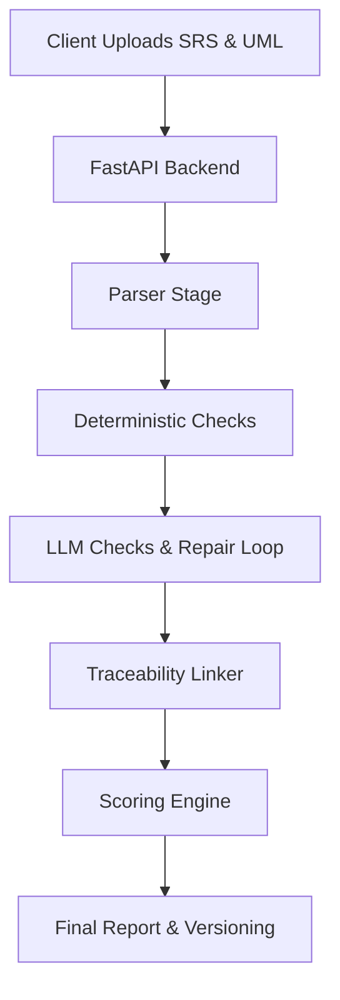

# SRS Reviewer

SRS documents are traditionally reviewed by hand, slowly and inconsistently; this tool checks that requirements, diagrams, and traceability agree.

SRS Reviewer is a hybrid rule-plus-LLM analyzer that parses your software requirements (DOCX/PDF) and PlantUML diagrams, detects architectural defects, and uses an agentic repair loop to proactively suggest testable rewrites for defective requirements.

## Architecture

## Pipeline Stages

1. **Parser Stage**: Extracts section hierarchies and individual requirement statements from DOCX or PDF files. Converts PlantUML text into an internal UML graph model.
2. **Deterministic Checks**: Runs high-speed regex and logic rules to find missing identifiers, duplicate IDs, ambiguous lexicon words, missing NFR metrics, and disconnected UML actors.
3. **LLM Checks & Agentic Repair Loop**: For requirements failing deterministic checks, the tool calls an LLM to rewrite them, feeding the output back into the deterministic parser up to 3 times until it passes. Also checks for logical conflicts and testability using the LLM.
4. **Traceability Linker**: Calculates Jaccard overlap and uses transitive tracing (Requirement -> Use Case -> Sequence -> Class) to build a traceability matrix.
5. **Scoring Engine**: Normalizes penalties by document size to calculate the final quality score.

## Quality scoring and evidence

Reviews select requirements-only or requirements-and-architecture scope. Rubric v2 exposes category percentages, eligible counts, and weighted contributions. Missing evidence is not full credit; empty or incomplete analysis has no final grade. Trace scores use stable coverage obligations, while candidate similarity and reviewer confirmation remain distinct. See [the analysis contract](docs/ANALYSIS_CONTRACT.md) for formulas, supported syntax, limitations, and provenance.

## Evaluation

See [the reproducible fixture results](backend/eval/results.md). The evaluator counts each occurrence independently, including missing and duplicate authored IDs. The original small dataset is a development fixture; it does not establish production accuracy or AI reliability. Its generic NFR labels require review under the updated threshold rule. Regression tests additionally cover document extraction, UML, tracing, scoring, access controls, and failure recovery.

## Setup

Use **Python 3.13 and Node 24**. See [the development guide](docs/DEVELOPMENT.md) for setup, migrations, environment configuration, recovery email, Docker, and verification. On Windows run `./run_backend.ps1`, then `npm ci` and `npm run dev` from `frontend`.

Implementation is proceeding in verified phases on `codex/project-improvements`. See [implementation status](IMPLEMENTATION_STATUS.md) for completed work and remaining acceptance gates. The evaluation above measures the original small deterministic dataset; it does not establish production accuracy or validate AI rewrites.

## Limitations

- The parser depends on standard IEEE numbering and the keyword "shall". Requirements written entirely in narrative form without identifiers or standard keywords may be skipped.
- PlantUML parsing relies on regex heuristics rather than a full grammar parser, so highly complex or nested diagram syntax might be misinterpreted.
- The LLM repair loop relies on external APIs (Groq), which means analysis requires an active internet connection and is subject to rate limits and API downtime.
