# SRS Reviewer

[](https://github.com/marbo786/SRS_Reviewer/actions/workflows/ci.yml)
[](LICENSE)


Upload an SRS and some PlantUML diagrams, and SRS Reviewer flags vague, conflicting or untraceable requirements. Every finding points back to the source text, every score shows how it was calculated, and AI rewrites stay proposals until a person accepts them.

It's built for SE students, instructors and small teams. It helps a human review a spec; it doesn't certify that one is correct or complete.

## What it does

- **Review requirements:** upload DOCX or text-based PDF files, check the extracted paragraphs and tables, and fix text, IDs or classifications before analysis.
- **Check architecture:** add named use-case, class and sequence diagrams (PlantUML) and find unresolved relationships, operation mismatches, disconnected elements and trace gaps.
- **Pick a scope:** requirements only, or requirements plus all three diagram types. Deterministic checks work with no AI service at all.
- **Read the results:** prioritized findings with quoted evidence, source locations, coverage, and scores with their weights. Incomplete runs are marked partial instead of getting a misleading grade.
- **Use AI suggestions (optional):** testability and conflict checks plus rewrite proposals, with validation and text diffs. Accept, edit or reject each one.
- **Trace requirements:** confirm or reject candidate links, add manual ones, and follow impact paths into the architecture.
- **Revise without losing history:** start a new draft, rerun, and compare findings between revisions. Old reports and source files stay available.
- **Share the output:** search and filter findings, print a full report, download the trace matrix as CSV.

Projects are private to their owner. Multi-user projects and classroom workflows are planned, not built.

## A quick example

Say the SRS contains "The catalog shall respond fast."

1. Upload the document and check the extracted requirement against its source.
2. Run a requirements-only analysis. An ambiguity finding flags the statement.
3. Work out a real response target with stakeholders (that call is yours, not the tool's).
4. Save the fix in a new draft and analyze again.
5. Compare reports to see what disappeared, stayed or showed up.

To try it, grab the [sample library SRS](frontend/public/Sample_Requirement/sample-requirements.docx) or hit "Try a sample review" on the dashboard.

## How it works

```mermaid
flowchart LR
    Sources[DOCX / text PDF / PlantUML] --> Draft[Extraction preview and draft corrections]
    Draft --> Run[Sealed revision and queued analysis]
    Run --> Checks[Deterministic checks]
    Checks --> AI[Optional bounded AI checks]
    AI --> Report[Findings, trace links and scoped scores]
    Report --> Review[Human review and decisions]
    Review --> Next[New draft and comparison]
```



React and TypeScript on the front, FastAPI behind a same-origin `/api` proxy. SQLAlchemy and Alembic handle the data. Docker runs Postgres, Redis and Celery; local dev uses SQLite and an in-process worker.

Analysis runs are queued through a transactional outbox with worker leases, checkpoints, cancellation and recovery, so a failed new run never wipes the last good report. Review decisions and manual links are annotations and never silently change a published score.

The AI gateway handles redaction, output validation, scoped caching, token and cost budgets, and usage auditing. Hosted inference goes through Groq. A loopback-only OpenAI-compatible adapter exists in `backend/app/llm/local_provider.py`, but its real-model quality hasn't been qualified.

## Getting started

You need Python 3.13 and Node 24.

**With Docker**

```bash
cp backend/.env.example backend/.env
docker compose up --build
```

The app is at http://localhost:5173 and the API is at http://localhost:8001.

**Without Docker**

```bash
cd backend
cp .env.example .env
pip install -r requirements.txt
python -m alembic upgrade head
uvicorn app.main:app --port 8000
```

In another terminal:

```bash
cd frontend
npm ci
npm run dev
```

Vite proxies `/api` to `127.0.0.1:8000`. The default `LLM_PROVIDER=mock` needs no API key. To use hosted AI, set `LLM_PROVIDER=groq` and `GROQ_API_KEY` in `backend/.env`.

**Tests**

```bash
cd backend
pip install -r requirements-dev.txt
python -m pytest tests/

cd ../frontend
npm run build
npm run test:browser
```

More detail in the [development guide](docs/DEVELOPMENT.md) and [workspace guide](docs/REVIEW_WORKSPACE.md).

## Limits worth knowing

- Scores only cover the selected scope and rubric. They're good for tracking comparable revisions, not for proving overall quality, and different scopes or rule configs aren't comparable.
- The parser handles a documented subset: ordered DOCX paragraphs and tables, text PDFs, and use-case, class and sequence PlantUML. Scanned PDFs need OCR, which isn't implemented. Text boxes, nested tables and exotic PlantUML aren't guaranteed.
- AI suggestions need a human check, especially when they add numbers, conditions or exceptions.
- The test suite covers regressions, not production accuracy, full accessibility conformance or usability.

## Status

This is an academic prototype demoed locally, not a production deployment. The upload, extraction, analysis, review and revision flow works end to end. Still open: downloadable PDF/DOCX reports and corrected documents, configurable rubrics, collaboration and classroom features, evaluated semantic suggestions, acceptance-test generation, and production hardening. The full list is in [remaining work](docs/REMAINING_WORK.md).

Deeper docs: [analysis contract](docs/ANALYSIS_CONTRACT.md), [AI safety](docs/AI_SAFETY.md), [revision history](docs/REVISION_HISTORY.md), [worker operations](docs/JOBS.md).

## License

[MIT](LICENSE)
