# SRS Reviewer

**Find unclear requirements, inspect the evidence, and check whether the design supports what the specification promises.**

SRS Reviewer is a requirements-review workspace for software engineering students, instructors, and small teams. It reads Software Requirements Specification (SRS) documents and PlantUML diagrams, runs rule-based checks and optional AI analysis, and helps a reviewer turn findings into a revised specification.

The aim is to make a review explainable and repeatable. A finding should lead back to source text; a score should show its scope and calculation; a proposed rewrite should remain a proposal until a person reviews it.

## The problem it addresses

A specification can look complete while leaving important questions unanswered. What does “respond quickly” mean? Are two requirements inconsistent? Does a sequence call an operation that exists on the receiving class? Which requirements have a path to the architecture, and which mappings are only guesses?

Reviewing those questions manually across documents and diagrams is slow. SRS Reviewer brings the source evidence, checks, trace links, and revision history into one place. It supports human review; it does not certify that a specification is correct or complete.

## What you can do today

- **Review requirements:** upload DOCX or text-based PDF files, inspect extracted paragraphs and table rows, and correct text, identifiers, or classifications before analysis.
- **Check architecture:** add multiple named use-case, class, and sequence diagrams in supported PlantUML syntax. Inspect unresolved relationships, operation mismatches, disconnected elements, and trace gaps.
- **Choose the scope:** run requirements-only checks, or evaluate requirements together with all three architecture diagram types. Deterministic checks work without an AI service.
- **Understand results:** see prioritized findings, quoted evidence, source locations, evaluated coverage, and category scores with their weights and contributions. Incomplete analysis is marked partial rather than assigned a misleading final grade.
- **Review AI suggestions:** optionally request testability/conflict checks and rewrite proposals through a bounded AI gateway. Inspect validation results and text differences, then accept, edit, or reject a proposal. Model agreement is not proof that intent was preserved.
- **Review traceability:** inspect candidate links and their evidence, confirm or reject mappings, add manual links, and follow architecture impact paths. Similarity values are not probabilities of correctness.
- **Revise without losing history:** create a new draft, apply corrections, rerun analysis, and compare requirement and finding changes. Earlier reports and source files remain available.
- **Use the workspace comfortably:** search and filter findings, reopen URL-linked review states, use keyboard/mobile navigation, switch themes, print a complete report, and download traceability CSV.

Projects are private to their owners. Multi-user project membership, instructor submission workflows, and shared review assignments are planned; they are not current product capabilities.

## A typical review

Suppose an SRS says **“The catalog shall respond fast.”**

1. Upload the document and inspect the extracted requirement against its source.
2. Run a requirements-only analysis. An ambiguity finding points to the statement that needs clarification.
3. Determine an appropriate response target with stakeholders. The reviewer—not the tool—decides the required behavior and its conditions.
4. Save the corrected statement in a new draft and analyze it again.
5. Compare reports to see which findings disappeared, persisted, or were introduced.

For a quick walkthrough, download the [synthetic library SRS](frontend/public/Sample_Requirement/sample-requirements.docx), or use **Try a sample review** on the dashboard. Adding UML diagrams extends the review to architecture consistency and traceability.

## How it works

```mermaid
flowchart LR
    Sources[DOCX / text PDF / PlantUML] --> Draft[Extraction preview and draft corrections]
    Draft --> Run[Sealed revision and queued analysis]
    Run --> Checks[Deterministic checks]
    Checks --> AI[Optional bounded AI checks]
    AI --> Report[Findings, trace links and scoped scores]
    Report --> Review[Human review and decisions]
    Review --> Next[New draft and comparison]
```

The React/TypeScript client talks to a FastAPI application through a same-origin API. SQLAlchemy and Alembic manage persistent project, revision, run, and review records. PostgreSQL, Redis, and Celery support the container-based worker setup; SQLite and a local worker support lightweight development.

Analysis runs use a transactional outbox, worker leases, checkpoints, cancellation, and bounded recovery. A failed newer run preserves the earlier successful report. Review decisions and manual links are annotations; they do not silently rewrite a published machine score.

The AI gateway applies redaction, validated outputs, scoped caching, request/token/cost budgets, and usage auditing. Hosted inference uses the configured Groq provider. A loopback-only OpenAI-compatible adapter is implemented in `backend/app/llm/local_provider.py`; real-model quality is not yet qualified.

## What the results mean

Scores summarize checks within the selected scope and rubric. They are useful for explaining identified problems and tracking comparable revisions, not for proving overall software quality. Missing or unextractable evidence does not earn full credit. Different scopes, rule configurations, or analysis versions can make scores non-comparable.

The parser supports a documented subset: ordered DOCX paragraphs/tables, text PDFs, and use-case/class/sequence PlantUML constructs. It recognizes supported requirement IDs and whole-word “shall” or “must” statements. Scanned PDFs need OCR, which is not implemented. Complex layouts, text boxes, nested tables, and arbitrary PlantUML syntax are not guaranteed.

AI suggestions require human judgment, especially when they introduce numbers, conditions, or exceptions. Existing automated tests and development fixtures establish regression behavior; they do not establish production accuracy, full accessibility conformance, or participant usability.

## Current status and remaining work

This project is prepared for a short demo, not a production-qualified deployment. The core upload → extraction → analysis → review → revision journey is implemented. Broader product extensions and release qualification remain outside the demo scope.

The main gaps are complete downloadable reports and corrected documents, configurable rubric templates, collaborative/classroom workflows, evaluated semantic suggestions, draft acceptance-test generation, and production operations/validation. See the [remaining-work checklist](docs/REMAINING_WORK.md) for a concrete breakdown and [implementation status](docs/archive/IMPLEMENTATION_STATUS.md) for evidence.

## Local video demo

Run the workspace on localhost for a short screen recording. The demo uses an isolated SQLite database, a local worker and scripted mock responses; it needs no hosted frontend, tunnel, SMTP or API key. It is not production-qualified.

Follow the [local quickstart](docs/DEMO.md), then the [60-second recording guide](docs/DEMO_VIDEO.md) for clips A–G. Reproducible v1/v2 specifications, diagrams, an API-only seeder and a Playwright screenshot workflow live in `demo/`. Mock output demonstrates human review controls, not real AI judgment.

## Run or contribute

Use **Python 3.13 and Node 24**. Follow the [development guide](docs/DEVELOPMENT.md) for installation, migrations, API and worker startup, Docker, and test commands. The [workspace guide](docs/REVIEW_WORKSPACE.md) explains the review flow.

| Area | Location |
|---|---|
| API, parsers, rules, AI gateway and workers | `backend/app/` |
| Database migrations and automated backend tests | `backend/alembic/`, `backend/tests/` |
| Review interface and browser tests | `frontend/src/`, `frontend/tests/` |
| Maintained verification and maintenance commands | `scripts/`, `backend/scripts/` |
| Analysis rules, operating guides and remaining work | `docs/` |

Further details: [analysis contract](docs/ANALYSIS_CONTRACT.md), [AI safety](docs/AI_SAFETY.md), [revision history](docs/REVISION_HISTORY.md), and [worker operations](docs/JOBS.md). Historical audit and feasibility documents are retained as project records; current behavior is described above and in the maintained guides.

## License

[MIT](LICENSE).
